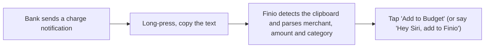

  
  <h1>Finio</h1>

  
<strong>Privacy-first budgeting from your bank notifications.</strong>

     

> **Showcase repository.** The source code for Finio is not published. This page presents what the product is and how it works.

## Overview

A budget tracker that parses bank charge notifications on-device: no bank login, no subscription, no data leaving the phone. Copy a notification (or tell Siri) and Finio files it in the right category.

## How it works

## Features

- Parser for 20+ banks and auto-categorization of 500+ merchants
- Siri / App Intents hands-free logging and a Share Extension
- Monthly category budgets, bills tracker with due reminders, savings goals
- Home-screen widgets (small and medium)
- Face ID local account, dark and light mode, CSV export
- 100% offline using App Groups

## Tech stack

| Layer | Choice |
|---|---|
| Language / UI | Swift, SwiftUI, iOS 17+ |
| Targets | App, Widget extension, Share extension |
| Integration | App Intents / Siri, Face ID, App Groups |
| Tests | NotificationParserTests + UI tests |

## Privacy & security

No bank login, no analytics, no server. All data stays on-device in an App Group.

## Brand

| | Name | Hex | Role |
|---|---|---|---|
|  | Burnt Orange | `#C2410C` | Accent (light) |
|  | Orange | `#F97316` | Accent (dark) |
|  | Slate | `#0F172A` | Text / dark |
|  | Alert Red | `#EF4444` | Danger |

**Mark.** Orange accent on a slate base; clean, finance-calm.

**Voice.** Plain, reassuring, privacy-first.

## Roadmap

- Pre-release polish
- More bank formats
- App Store launch

## License

Proprietary. Shared publicly for portfolio and demonstration purposes only. See [LICENSE](LICENSE).

---

Built by [Aquila Digital LLC](https://github.com/Steven6Brown) · *Per Aspera Ad Astra*

